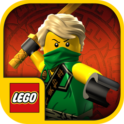
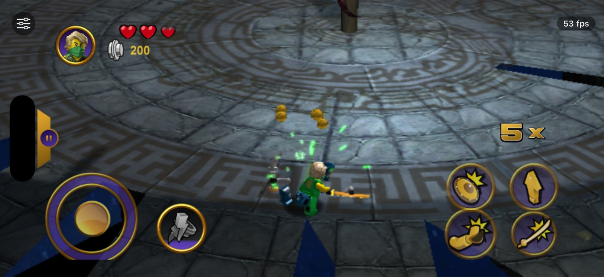
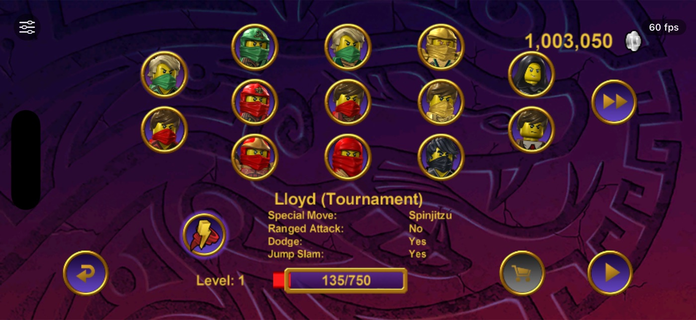
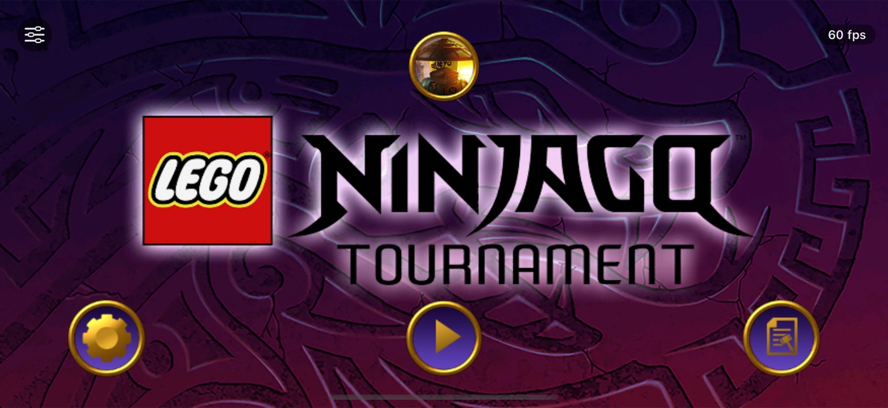
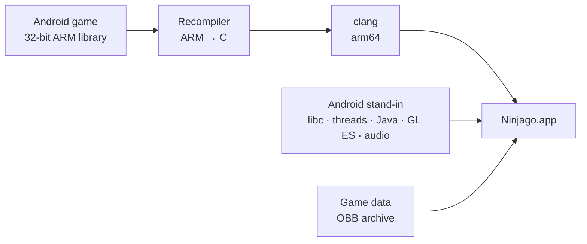

<p align="center">
  
</p>

<h1 align="center">Ninjago Tournament for iOS</h1>

<p align="center">
  LEGO® NINJAGO®: Tournament, running natively on iPhone 17 and iOS 27.
</p>

<p align="center">
  
  
  
  
</p>

<p align="center">
  
  
</p>

Ninjago Tournament stopped working on iPhones when iOS dropped 32-bit apps. This project turns the game's last
Android release back into a native iOS app: the game's own engine code, translated ahead of time to 64-bit, with its
original arenas, characters, music and touch controls. It installs like any other app built in Xcode and needs no
jailbreak or emulator.

## Features

- **The original game.** The Android release's own engine code, translated function by function to native arm64,
  so no reimplementation, no emulator and no JIT.
- **Smooth on current iPhones.** Full 2622 × 1206 resolution on iPhone 17: 60 fps in menus and about 57 fps in
  arena fights.
- **Every character.** All ninjas and villains unlocked and ready in the character select.
- **An options sheet.** All levels, super moves and red-brick extras, a stud multiplier, unlimited studs and prize
  draws, invincibility, extra hearts, faster healing and double damage, each one a switch. They use switches the
  game already has, and unlocks never change your save.
- **Controls where your thumbs are.** The D-pad and buttons sit inside the rounded corners and clear of the Dynamic
  Island, without black bars.
- **Touch as on Android.** Several fingers at once, in Android's order, so moving and attacking together works.
- **Saves that stay.** Progress is stored on the device and survives app updates.
- **The original icon.** With your copy of the old iOS version, its App Store artwork becomes the app icon.
- **Built for development.** A Simulator build, scripted test taps and a one-command test that plays an arena fight
  on a connected iPhone.

<p align="center">
  
  
</p>

## Requirements

- A Mac with Xcode 27, CMake, Ninja, [XcodeGen](https://github.com/yonaskolb/XcodeGen) and Python 3
- An iPhone with iOS 26 or later (tested on iPhone 17 with iOS 27), or the iOS Simulator
- Your own copy of the Android game, version 1.05.2 (XAPK)
- Optional: your copy of the original iOS version (IPA), for the app icon

| File | SHA-256 |
|---|---|
| `ninjago-android-1.05.2.xapk` (package `com.lego.ninjago.toe`) | `2f99900b3687c6c05243f6604ab28d365312a1c21f2f01f5489aad51c1c5b96b` |
| `lib/armeabi-v7a/libLEGO_M1.so` from its `base.apk` | `0125c9766168a80d8ee84348d4028382f326d4a8ea5f6f1d8250a434fc1e69b3` |
| `ninjago-ios-1.1.70250.ipa` (optional) | `880a6e5c60b06243165e4cc56ed19d6de3d30ad2913aa2988760d5e6b86733d0` |

## Getting started

```sh
# 1. Your game files (git-ignored)
mkdir -p input/extracted && unzip ninjago-android-1.05.2.xapk -d input/extracted
unzip -o input/extracted/base.apk 'lib/armeabi-v7a/libLEGO_M1.so' -d input/extracted
cp ninjago-ios-1.1.70250.ipa input/          # optional: the original app icon

# 2. Build the recompiled game and run the tests
python3 -m venv tools/.venv && tools/.venv/bin/pip install -r tools/requirements.txt
cmake -S . -B build -G Ninja && cmake --build build && (cd build && ctest)

# 3. Play: in the Simulator, or on your iPhone (set DEVELOPMENT_TEAM in ios/project.yml first)
tools/sim/run_sim.sh 0
(cd ios && xcodegen generate) && open ios/Ninjago.xcodeproj    # run the NinjagoPhone scheme
```

The app is built from your files on your Mac and installed on your own devices. `tools/device/smoke.sh` checks an
installed iPhone build without touching your save: it plays from the main menu into the dojo, or with `--fight` into
an arena fight.

## How it works

The Android release is TT Games' C++ engine, compiled for 32-bit ARM. This project translates that machine code into
C once, on your Mac, and gives it a stand-in for Android to talk to.



- **Game code**: all 14,118 functions of the ARM library are translated to C ahead of time and compiled by clang for
  arm64. The translation is checked instruction by instruction against a CPU emulator.
- **Android stand-in**: the 208 functions the game imports (libc, threads, OpenGL ES, OpenSL ES) and the Java calls
  it makes are answered by a runtime written for this project.
- **Graphics and touch**: OpenGL ES 2 goes to iOS's OpenGL ES with shader fixes and texture conversion; touches
  arrive in Android's order.
- **Options**: switches the shipped game already contains, set once per frame.

The technical notes cover every step, the numbers and the problems found on the way:
[`docs/technical-notes.md`](docs/technical-notes.md).

## Status

| | |
|---|---|
| iPhone 17, iOS 27 | Plays: menus, dojo, arena fights, prize draw, saves. Arena fight test passed 3 of 3 at about 57 fps |
| iOS Simulator | Runs for development (renders at 1× because the Simulator draws OpenGL ES in software) |
| Next | More tournament levels played through on the device |

## Project layout

| Path | Contents |
|---|---|
| `tools/recomp/` | the static recompiler: function discovery, instruction lifting, C emission |
| `runtime/` | guest memory, ELF loader, the Android stand-in, the arm64 backend and an emulator backend for testing |
| `harness/` | Android-style boot sequence, frame and touch entry points, the options (`cheats.c`) |
| `ios/` | the iOS app: GL view, touches, audio, options sheet |
| `tools/sim/`, `tools/device/` | Simulator runs and the iPhone smoke test |
| `tests/` | unit tests and the differential test rigs |
| `docs/` | [technical notes](docs/technical-notes.md), [options](docs/options.md), [Java contract](docs/java-contract.md), [design](docs/design/), screenshots |

## Legal

This repository contains only original tooling. No game code or game data is included, and nothing generated from
them is committed: you need your own copy of the game. This is a personal preservation project and is not
affiliated with or endorsed by the LEGO Group, Warner Bros. Games, TT Games or Hellbent Games. LEGO, the LEGO logo
and NINJAGO are trademarks of the LEGO Group. Third-party components are listed in [THIRD_PARTY.md](THIRD_PARTY.md).

## Credits

Made by **Miró Waltisberg**. Code under the [MIT license](LICENSE).

Also by Miró: [**Yoda Chronicles for iOS**](https://github.com/mirowaltisberg/yoda-chronicles-recomp).
