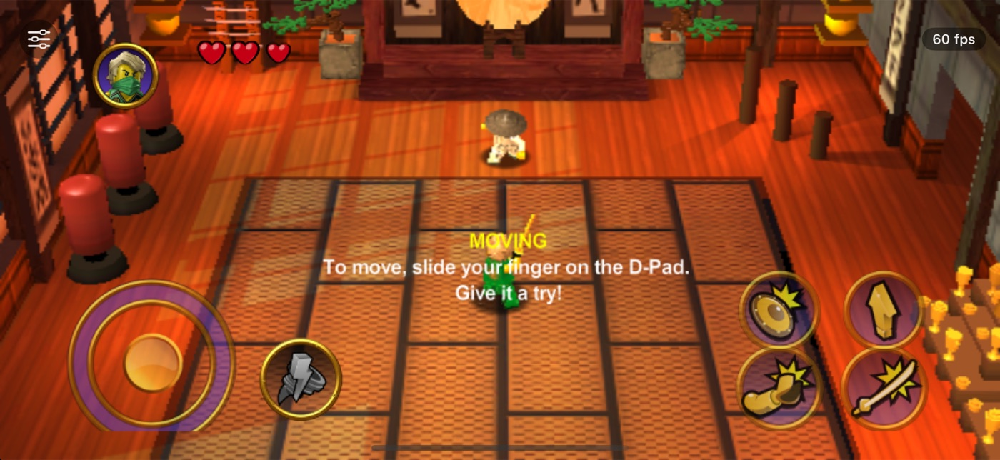
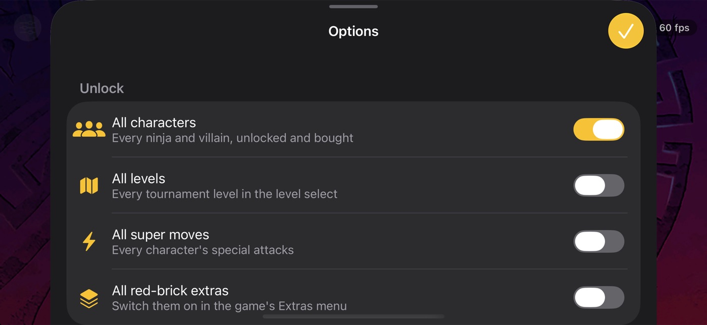
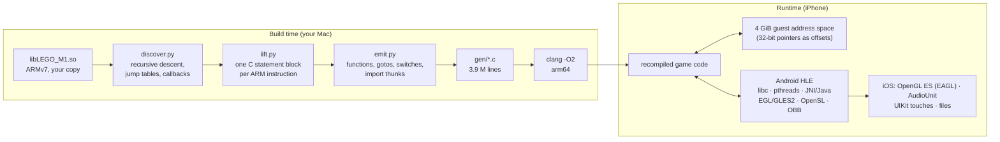

# LEGO Ninjago Tournament, recompiled for iOS

**A 32-bit Android game, translated function by function into native 64-bit iOS code.** No source code, no emulator
at runtime, no JIT: the game's ARMv7 engine is statically recompiled to C, compiled by clang for arm64, and runs on
an iPhone 17 at 60 fps on top of a hand-written imitation of the Android platform.

<p align="center">
  
  
</p>

> **No game code or data is in this repository.** You need your own copy of the Android game (version 1.05.2).
> The translation of the game's code is generated on your machine and is never committed. This is a personal
> preservation project, not affiliated with the LEGO Group, Warner Bros. Games, TT Games or Hellbent Games.

## Why this was hard

LEGO Ninjago Tournament is long gone from the stores. What survives is the Android build: a 4.4 MB stripped
`libLEGO_M1.so` (TT Games' C++ "Fusion" engine, 32-bit ARM) plus a 974 MB asset archive. Getting that onto a
current iPhone runs into four walls at once:

| Wall | Why it matters | What this project does |
|---|---|---|
| **iOS has not run 32-bit code since iOS 11** | The only binary is ARMv7. Even the old iOS version of the game is 32-bit only. | Every one of the 14,118 ARM functions is translated to C ahead of time and compiled for arm64. |
| **iOS apps cannot generate code at runtime** | No JIT, so no fast emulator. An interpreter would not hold 60 fps. | Static recompilation: the whole program is discovered and translated before the app is built. |
| **The game expects Android** | bionic libc, pthreads, a Java VM via JNI, EGL/OpenGL ES 2, OpenSL ES, APK/OBB assets, Qualcomm-only textures. | A high-level emulation (HLE) layer implements all 208 imported functions and the Java side the engine calls back into. |
| **Nothing to compare against** | No source code, no 32-bit iPhone, no debugger on the original. | Differential testing against the Unicorn CPU emulator: instruction by instruction, function by function, and whole-boot call traces. |

## Results

| | |
|---|---|
| Functions translated | **14,118**; 6 of them (C++ exception-unwinder helpers using iWMMXt instructions) become stubs that fail loudly; no test or play session has hit one |
| Generated code | **3.9 million lines of C** in 64 files, compiles in about 24 s |
| Speed on iPhone 17 | **60 fps**, about 1–4 ms of CPU per frame |
| Compared with the emulator | about **9× less CPU** than running the same game on Unicorn in the same harness |
| Instruction-level check | **2,600** instruction shapes × 64 random CPU states, bit-exact with Unicorn (including NaN payloads) |
| Function-level check | **293** self-contained functions with random inputs, registers *and* globals compared |
| Test suites | 23 (CTest), plus Simulator tests for GPU behaviour |

## How it works



- **Discovery** (`tools/recomp/discover.py`) walks the code from every exported symbol, constructor and callback,
  follows calls and branches, decodes `add pc, pc, rX` jump tables and finds functions reached only through
  pc-relative address arithmetic. Thumb code is only assumed with positive evidence.
- **Lifting** (`lift.py`) turns each ARM instruction into C operating on a register context: conditional
  execution, flags, shifts, VFP floating point, load/store addressing modes. Flag and addressing semantics are
  decoded from the instruction bits instead of being trusted from the disassembler.
- **Emitting** (`emit.py`) builds real C functions: intra-function branches become `goto`, calls become direct C
  calls, imports go through HLE thunks, returns are checked against the link register in debug builds.
- **The runtime** (`runtime/`) reserves a 4 GiB region so the game's 32-bit pointers stay valid as offsets, then
  plays Android: a bionic-compatible libc, pthreads mapped to host threads, a small JNI VM that answers the
  engine's Java calls, EGL/GLES2 forwarded to iOS OpenGL ES with shader patches, Qualcomm ATC textures decoded to
  RGBA on upload, OpenSL ES on an AudioUnit, and the OBB zip served as the APK's asset manager.
- **The app** (`ios/`) drives `nativeRender` from a 60 Hz display link and translates UIKit touches into
  Android's `MotionEvent` order.

## The hard parts

**Trusting the CPU, not the disassembler.** Capstone reported the wrong flag behaviour for `sbc` and inconsistent
memory-operand details. Both showed up as single failing cases in the instruction-level difftest; the lifter now
reads the S bit and the P/U/W/I addressing bits straight from the encoding.

**Finding all the code.** A stripped binary does not say where functions start. `__aeabi_uidivmod` enters in the
middle of itself (the translation starts with a `goto`), two static constructors are Thumb code (replaced by
byte-checked host overrides), and some callbacks exist only as `ldr rX, =offset; add rY, pc, rX`. Every one of
these crashed the first boot and now has a regression test.

**Proving equivalence without the original hardware.** Three layers: `difftest` generates every instruction shape
the game uses and runs it with random register states on both backends; `funcdiff` runs 300 whole functions with
the game's writable data snapshotted; `tracediff` compares every HLE call of a 600-frame boot. The main thread
matches the emulator call for call until timing between threads diverges, which is expected: the recompiled game
is 9× faster.

**Being Android convincingly.** The engine talks to a Java activity: it asks for paths, device strings, the asset
manager, OBB entries and analytics. `docs/java-contract.md` records the contract recovered from the decompiled
Java side; the HLE layer answers it.

**Touch is a protocol.** Android sends the first finger as `ACTION_DOWN` and further fingers as
`ACTION_POINTER_DOWN`, and the engine resets all touch state on the first one. Mapping them the wrong way round
made the D-pad register a new swipe whenever a second finger touched the screen.

**Safe areas without black bars.** The game anchors its controls to the screen edges, which on a modern iPhone
means under the rounded corners and the camera. The GL layer recognises the 2D overlay drawn after the 3D scene,
draws it slightly scaled towards the centre and maps touches back, while full-screen backgrounds stay full-screen.

**Two bugs that were not bugs.** The Simulator showed black floors: its software renderer mis-clips triangles
behind the camera, the device does not. The prize draw's back button "did nothing": the game's own state machine
only accepts back after you continue past the result, and it saves at that moment.

## Options

The port has an options sheet (slider button in the corner). Every switch uses a mechanism the shipped game
already contains, including developer cheat bits whose setter is dead code in the release build. The full
reverse-engineering trail is in [`docs/options.md`](docs/options.md).

| Section | Options |
|---|---|
| Unlock | all characters (on by default), all levels, all super moves, all red-brick extras |
| Studs | stud multiplier off / ×2 / ×4 / ×6, never run out of studs, unlimited prize draws |
| Easier fights | invincible, extra hearts, faster healing, double damage |
| Display | controls inside the safe area, frame-rate display |

Unlocks never change the save: switch one off and the game shows your own progress again.

## Building it yourself

You need a Mac with Xcode, CMake, Ninja, [XcodeGen](https://github.com/yonaskolb/XcodeGen) and Python 3, and your
own copy of the Android game:

| File | SHA-256 |
|---|---|
| `ninjago-android-1.05.2.xapk` (package `com.lego.ninjago.toe`) | `2f99900b3687c6c05243f6604ab28d365312a1c21f2f01f5489aad51c1c5b96b` |
| `lib/armeabi-v7a/libLEGO_M1.so` from its `base.apk` | `0125c9766168a80d8ee84348d4028382f326d4a8ea5f6f1d8250a434fc1e69b3` |

```sh
# 1. Your game files (git-ignored)
mkdir -p input/extracted && unzip ninjago-android-1.05.2.xapk -d input/extracted
unzip -o input/extracted/base.apk 'lib/armeabi-v7a/libLEGO_M1.so' -d input/extracted
#    -> input/extracted/lib/armeabi-v7a/libLEGO_M1.so
#    -> input/extracted/Android/Obb/com.lego.ninjago.toe/main.1057.com.lego.ninjago.toe.obb

# 2. Tools, translation and tests
python3 -m venv tools/.venv && tools/.venv/bin/pip install -r tools/requirements.txt
cmake -S . -B build -G Ninja && cmake --build build && (cd build && ctest)

# 3. Run it in the Simulator
tools/sim/run_sim.sh 0

# 4. On an iPhone: generate the project, open it, pick your team, run the NinjagoPhone scheme
(cd ios && xcodegen generate) && open ios/Ninjago.xcodeproj
```

The phone build bundles your `.so` and `.obb`, so it stays on your own devices.

## Repository map

| Path | What |
|---|---|
| `tools/recomp/` | the static recompiler (discovery, lifter, emitter) |
| `runtime/` | guest memory, ELF loader, HLE layer, the AOT backend and the Unicorn backend used for testing |
| `harness/` | Android-style boot sequence, frame and touch entry points, the options (`cheats.c`) |
| `ios/` | the iOS app (Objective-C): GL view, touches, audio, options sheet |
| `tests/` | unit tests, `difftest/`, `funcdiff/` |
| `docs/` | Java contract, device memory probe, milestone reports, options, design and plan |

## License and credits

The code in this repository is MIT licensed, see [LICENSE](LICENSE); third-party components are listed in
[THIRD_PARTY.md](THIRD_PARTY.md). LEGO, the LEGO logo and NINJAGO are trademarks of the LEGO Group. The game
belongs to its rights holders and is not included.

Built by **Miró Waltisberg**, with [Claude Code](https://claude.com/claude-code) as pair programmer.
